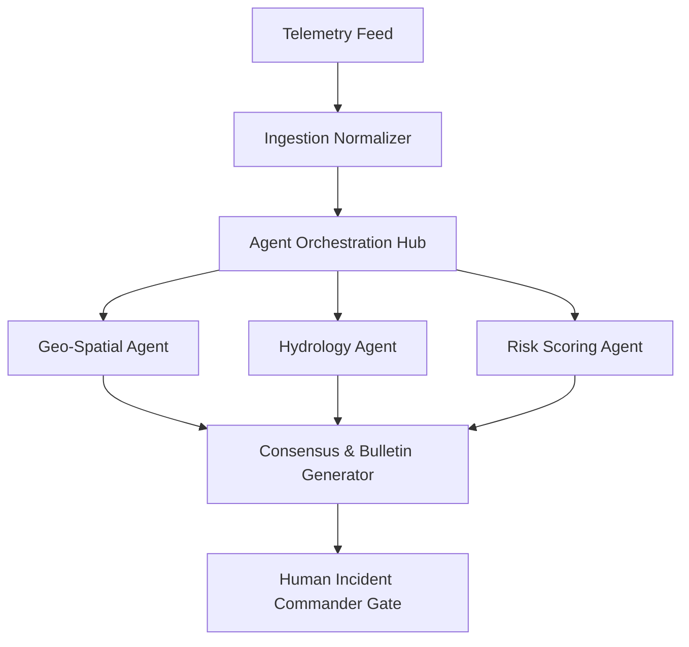

During natural disasters (typhoons, flash floods, seismic events), municipal Emergency Operations Centers (EOCs) face extreme operational friction: **data fragmentation under severe time pressure**.

Sensor feeds, Doppler radar models, river gauges, civic distress calls, and field responder dispatches pour into command centers simultaneously. Human operators must manually cross-reference conflicting telemetry, verify inundation boundaries against civil maps, and draft official warnings—a process that routinely takes **hours** while floodwaters rise.

To eliminate this life-critical bottleneck, we engineered an **AI Emergency Operations Copilot** that reduces disaster warning synthesis from hours to seconds.

Achieving this required solving a fundamental distributed systems challenge: **orchestrating autonomous specialized agents reliably without non-deterministic hallucinations.**

import { Mermaid } from "@/components/common/Mermaid";

<div className="card p-6 md:p-8">
  <Mermaid chart={frontmatter.chart} />
</div>

---

## Why Monolithic Prompts Fail Under Real-Time Constraints

Early architectural experiments attempted to pass all telemetry feeds into a single large-context LLM prompt: _"Read these 20 sensor streams and draft public evacuation warnings."_

This approach failed in production:

- **Context Saturation & Lost Invariants**: High-volume sensor arrays flood the context window, causing models to overlook critical threshold breaches in remote sub-districts.
- **Hallucinated Coordinates**: Language models cannot calculate polygon intersections or geospatial distances reliably. They frequently assigned incorrect GPS perimeters to civic hazard zones.
- **Sequential Latency**: Generating a massive, multi-faceted analytical report in a single conversational turn took 45 to 90 seconds—unacceptable during emergency triage.

---

## 2. Multi-Agent Orchestration Architecture

Rather than a single monolithic model, the system is designed as a **decoupled pipeline of specialized autonomous agents** coordinated via an asynchronous event bus:



### The Specialist Agent Roster

Each sub-agent has a strictly bounded domain:

- **Geo-Spatial Agent**: Computes spatial perimeters, identifying intersecting critical infrastructure (hospitals, bridges, evacuation centers, power grids).
- **Hydrology Agent**: Compares real-time rainfall rate and gauge sensors against historical flood inundation curves.
- **Risk Severity Agent**: Computes standardized civil defense risk indices based on population density and rate of hazard propagation.

---

## Deterministic Tool Execution over Prompt Math

Specialist agents are strictly prohibited from performing mathematical, spatial, or statistical calculations inside their natural language prompt generation.

Instead, agents invoke **compiled deterministic tools**:

```json
{
  "agent": "GeoSpatialSpecialist",
  "action": "execute_tool",
  "tool_name": "postgis_compute_hazard_zone",
  "parameters": {
    "river_basin_id": "basin_north_08",
    "water_level_m": 4.85,
    "soil_saturation_pct": 92
  }
}
```

The compiled spatial database executes optimized geometric intersection queries:

```sql
SELECT
    b.district_id,
    b.population_density,
    ST_AsGeoJSON(ST_Intersection(b.geom, :hazard_polygon)) as impact_polygon
FROM municipal_boundaries b
WHERE ST_Intersects(b.geom, :hazard_polygon);

```

The compiled spatial engine returns the exact polygon coordinates and impacted civic assets, which the agent incorporates into the bulletin payload with 100% mathematical accuracy.

---

## Mandatory Human-in-the-Loop Verification

In life-and-death disaster dispatch, fully autonomous publication is irresponsible.

The multi-agent pipeline completes 99% of the cognitive labor in under 5 seconds:

- Aggregates multi-source telemetry.
- Validates geospatial perimeters against PostGIS.
- Drafts Common Alerting Protocol (CAP) compliant public warning text.
- Formulates multi-channel dissemination formats (SMS broadcasts, social media alerts, siren triggers).

The verified draft is surfaced to the incident commander's dashboard with highlighted source citations, confidence scores, and affected population figures. The commander reviews the bulletin and authorizes city-wide broadcast with a single keystroke.

---

## Quantitative Impact

- **Bulletin Synthesis Time**: Cut from **2 hours 15 minutes** down to **sub-5 seconds**.
- **Spatial Precision**: 100% deterministic polygon boundaries via PostGIS integration.
- **Operational Clarity**: High-signal telemetry synthesis eliminates cognitive overload for disaster response teams.
